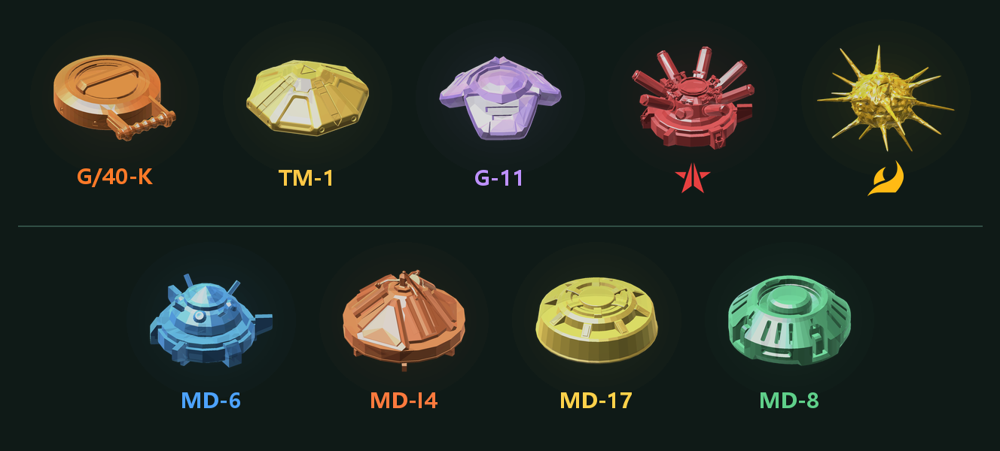

# 地雷高亮 / Mines Highlight

给游戏里的地雷和雷类战备罩一层自发光外壳，再在顶部加一束竖直光柱，远处也能一眼看到，不用再贴着地面找雷。

## 效果

- **高亮**：整颗雷外面套一层发光外壳，夜战、烟里、草丛中都看得见。
- **光柱**：每颗雷顶部有一束竖直光柱，颜色跟这颗雷对应，从远处就能判断方位。
- **只改外观**：伤害、触发范围、爆炸效果、布置数量都不变，也不影响雷的实际判定。

## 包含的雷

九个选项各自独立，可以只勾选你需要的。

| 选项 | 编号 |
| --- | --- |
| 反步兵地雷 | MD-6 |
| 燃烧地雷 | MD-I4 |
| 反坦克地雷 | MD-17 |
| 毒气地雷 | MD-8 |
| 热熔地雷 | G/40-K |
| 诱饵地雷 | TM-1 |
| 铁蒺藜 | G-11 |
| 机器人地雷 | — |
| 终结族地雷 | — |

最后两项是敌人布设的雷。

## 使用

1. 用 Arsenal 导入本 mod 的压缩包。
2. 在选项里勾选需要的雷，不想要的取消勾选。
3. 完全退出游戏后再部署，改动在下次进入任务时生效。
