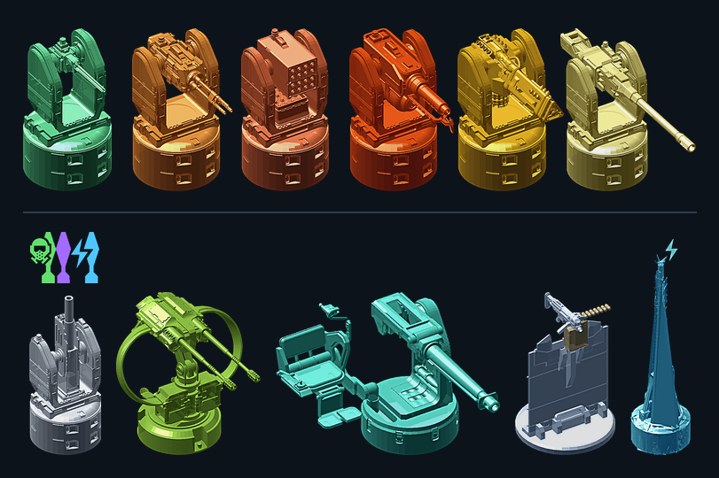

# 炮塔阵地弹药显示 / Sentry Ammo Display

在 13 种炮塔与阵地的头顶画出弹药条、热量或倒计时，不用跑到跟前看面板。

## 显示的是什么

- **有弹匣的单位**：四格弹药条 + 剩余发数。
- **激光哨戒**：热量，不是弹数。
- **特斯拉塔**：没有弹匣，显示按部署剩余时间估算的倒计时。

## 包含的炮塔

分成五组，各自独立勾选。

| 分组 | 炮塔 |
| --- | --- |
| 实弹哨戒 | 机枪 / 加特林 / 自动 / 火箭 / 火焰 |
| 迫击炮 | 迫击 / 电磁迫击 / 毒气迫击 |
| 激光哨戒 | 激光哨戒 |
| 特斯拉塔 | 特斯拉塔 |
| 阵地 | 重机枪 / 反坦克 / 榴弹兵墙 |

## 前提

已安装 MDL3 dev.32 或更新版本。本 mod 由 MDL3 启动，没有独立启动方式。

## 使用

1. 完全退出游戏。
2. 用 HD2Arsenal 导入本 mod 的压缩包。
3. 勾选「核心（必选）」，再按需勾选分组，不勾的组不会显示。
4. 部署，进入游戏。

## 设置

ESC → MDL3 设置 → MOD 设置 → 炮塔阵地弹药显示。字号、图标大小、弹药条宽高、远近缩放、遮挡透明度等都在这里，由 MDL3 保存。

## 日志

`%LOCALAPPDATA%\SentryAmmoOverhead.log`，每次启动重写。
