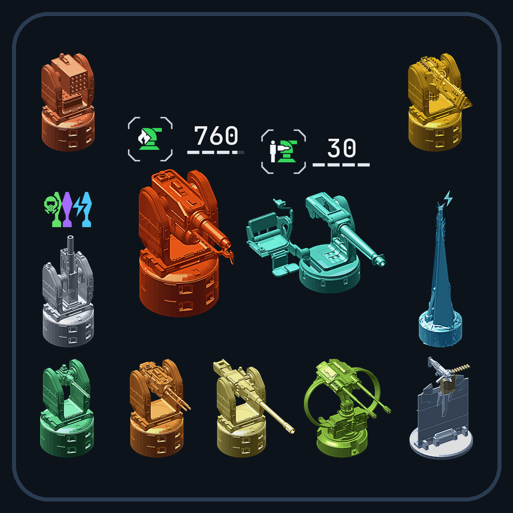

# 炮塔阵地弹药显示 / Sentry Ammo Display

在所有17种玩家可部署的哨戒炮、防御阵地、武装重新补给舱与载具炮位上绘制弹药、热量或倒计时提示。

## 显示的是什么

- **有弹匣的单位**：弹药条 + 剩余弹药发数。
- **激光哨戒**：热量百分比。
- **特斯拉塔**：按部署剩余时间估算的存续倒计时。

## 包含的炮塔

分成七组，各自独立勾选。

| 分组 | 炮塔 |
| --- | --- |
| 实弹哨戒 | 机枪 / 加特林 / 自动 / 火箭 / 火焰 |
| 能量哨戒 | 激光哨戒 |
| 迫击炮 | 迫击 / 电磁迫击 / 毒气迫击 |
| 特斯拉塔 | 特斯拉塔 |
| 固定阵地 | 重机枪 / 反坦克 / 榴弹兵墙 |
| 移动阵地 | 快速侦察载具（重机枪） / 重型快速侦察载具（喷火） |
| 武装补给 | 武装重新补给舱 / 补给型快速侦察载具 |

## 使用

1. 在模组管理器（如 HD2Arsenal）中导入本 mod ，并确保前置加载器 MDL3（dev.57+）已部署。
2. 在本模组选项中勾选「核心（必选）」和所需的炮塔分组。
3. 部署，进入游戏。

## 日志

`%LOCALAPPDATA%\SentryAmmoDisplay.log`，每次启动重写，每行带 `HH:MM:SS` 时间戳。

- `SENTRY-AMMO version=… build=…` 是第一行，记下模组版本与 profile 对应的游戏 build。
- 状态行每 15 秒一条，其中 `network=` / `identity=` 是失败原因；`records=0` 表示没有采到任何炮塔。
- `SENTRY-NETWORK` 与 `SENTRY-IDENTITY` 只在出错时出现，带具体位置，例如
  `SENTRY-NETWORK bindings invalid_static_bindings bindings[57] model_missing model=2eecd0b1fa49630 type=3416fff4`。
- `SENTRY-CENSUS <资源路径> units=N` 在首次查询时每个模型打一条，`units=0` 说明该模型在场上一个都没找到。
- `SENTRY-IDENTITY unbound model=… nearest_type=… distance=…` 表示这台单位找到了、但网络类型不在本模组认识的列表里；
  `no_network_objects` 则表示连对应的网络对象都没有。
- `SENTRY-API …` 在启动时打印引擎各模块暴露的接口名，用于核对可用能力。
